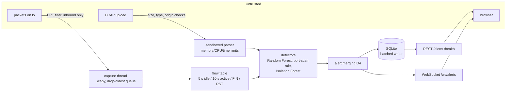

# SentinelStream

Real-time network intrusion detection on a single laptop CPU. SentinelStream captures live traffic (or reads a PCAP), groups packets into flows, scores each flow with machine-learning detectors, and streams alerts to a React dashboard over WebSocket.

> **Status: all seven phases complete.** Try it: [Quick start](#quick-start) or [docs/DEMO.md](docs/DEMO.md). See [docs/PHASES.md](docs/PHASES.md) for the plan and [PROGRESS.md](PROGRESS.md) for what's done.

## What it does

- **Live capture** from an interface (default `lo`) with Scapy, non-blocking, with a bounded queue that drops the oldest packets under load.
- **Flow features**: duration, forward/backward packet counts, total bytes, packets/s — one shared definition used for training and live inference.
- **Detection**: a Random Forest trained on CICIDS2017 and a port-scan rule that name attack types, plus an Isolation Forest that flags unnamed anomalies.
- **Dashboard**: live alert feed with severity and attack-type filters, packets/s chart, attack distribution, PCAP upload.
- **Offline and free**: no cloud, no paid APIs, no GPU, no telemetry.

Built for a junior SOC analyst or IT admin at a small organisation who wants one browser tab of live alerts.

## Architecture



Components, the three data flows (live, upload, offline training) and the trust boundary are in [docs/ARCHITECTURE.md](docs/ARCHITECTURE.md).

## Quick start

Linux with Docker Compose (host networking is what lets the backend capture the host's loopback):

```bash
docker compose up --build
```

Open <http://localhost:3000>. To also run a port scan against your own machine once the backend is up:

```bash
docker compose -f docker-compose.yml -f docker-compose.demo.yml up --build
```

The alert appears in the dashboard as **High · PortScan · Port-scan rule**. Without Docker, follow [docs/DEMO.md](docs/DEMO.md) (about 5 minutes). Both paths use the committed models: no dataset download is needed.

## Results

Held-out CICIDS2017 test split, all three detectors on the same rows. Reproduce with `python backend/evaluation/benchmark.py --csv-dir data/raw/cicids2017/MachineLearningCVE` (full output: [docs/benchmark/results.md](docs/benchmark/results.md)).

| Detector | Precision | Recall | F1 | FPR (benign) | PR-AUC | Recall @1% FPR | Latency p50 (ms) | Latency p95 (ms) |
|---|---|---|---|---|---|---|---|---|
| PPS rule | 0.0575 | 0.0026 | 0.0050 | 0.9990% | 0.1208 | 0.0026 | 0.022 | 0.030 |
| Isolation Forest | 0.0103 | 0.0005 | 0.0009 | 1.0347% | 0.3943 | 0.0004 | 15.088 | 16.126 |
| Random Forest | 0.9245 | 0.9973 | 0.9595 | 1.9166% | 0.9922 | 0.9192 | 4.034 | 4.352 |

**Live default: Random Forest + port-scan rule + Isolation Forest** (human decision, Phase 5). Per flow, the Random Forest names the attack; only when it says benign can the Isolation Forest raise a `low`/`medium` `anomaly`; the scan rule works across flows. Why: the Random Forest carries detection on known attacks (F1 0.9595, PR-AUC 0.9922, ~4 ms per flow). The Isolation Forest adds almost nothing on CICIDS2017 attacks (recall 0.0005; 0.0000 on held-out PortScan) and caused every live false positive measured in Phase 2, but it is kept as the only net for patterns no training label covers, with its alerts capped at `medium` and merged by D4. The scan rule is the only detector that names a port scan reliably on live traffic.

Caveats: a random split puts flows from the same attack session in both training and test, so these scores are optimistic; exact duplicates were removed first (39% of rows; PortScan drops from 158,930 to 1,612), and 4,382 rows share their 5 features with a row of another label. Latency columns are wall-clock and vary run to run; every other number is identical on re-run.

## Documentation

| Doc | Contents |
|---|---|
| [docs/PRD.md](docs/PRD.md) | Problem, users, requirements |
| [docs/ARCHITECTURE.md](docs/ARCHITECTURE.md) | Components, threads, data flows, trust boundary |
| [docs/DATA_MODEL.md](docs/DATA_MODEL.md) | SQLite schema, feature subset, model artifacts |
| [docs/API_SPEC.md](docs/API_SPEC.md) | REST and WebSocket API |
| [docs/PHASES.md](docs/PHASES.md) | Build plan and acceptance gates |
| [docs/EVALUATION.md](docs/EVALUATION.md) | Datasets, metrics, benchmark method |
| [docs/LIMITATIONS.md](docs/LIMITATIONS.md) | What it can't do, and why |
| [AGENTS.md](AGENTS.md) | Rules for anyone (human or AI) working on the repo |

## Stack

Python 3.11+, Scapy, pandas, NumPy, scikit-learn, FastAPI, Uvicorn, SQLite · React 18, Vite, Tailwind CSS, Recharts · pytest, Vitest · Docker Compose, GitHub Actions.

## Citation

Trained on CICIDS2017: Sharafaldin, Lashkari, Ghorbani, "Toward Generating a New Intrusion Detection Dataset and Intrusion Traffic Characterization", ICISSP 2018.

## License

MIT, see [LICENSE](LICENSE). Contributions: [CONTRIBUTING.md](CONTRIBUTING.md).
